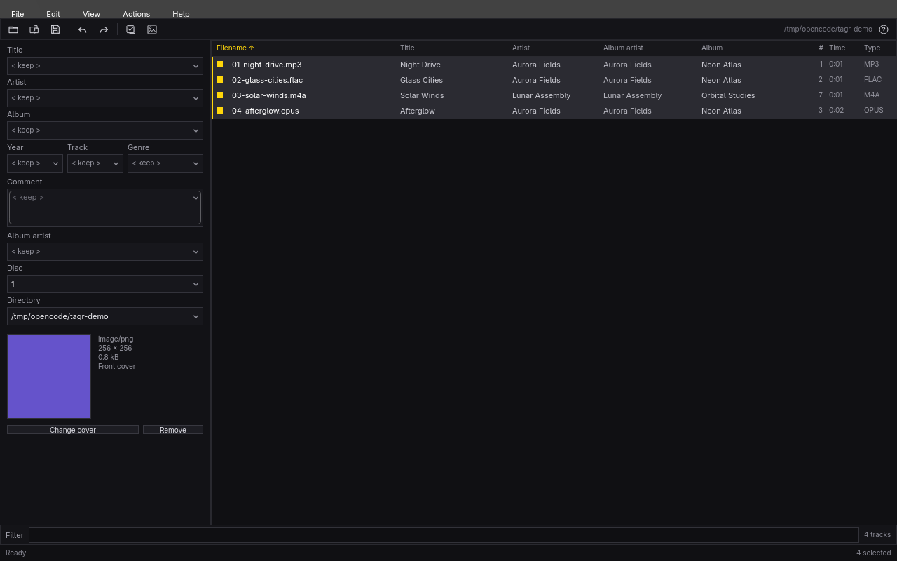

# Tagr

Tagr is a native, keyboard-first audio tag editor for Omarchy, inspired by Mp3tag's core editing workflow. It uses C++, Qt Quick, and TagLib—no Wine and no audio re-encoding.

## Features

- Browse a folder recursively or open individual audio files.
- Sort and filter the track list.
- Show or hide track list columns through the **View → Column visibility…** menu, with per-column choices persisted in `tagr.ini`.
- Edit title, artist, album, album artist, genre, year, track, disc, comment, and MusicBrainz Picard IDs (release, album, artist, track, release group) for one or many selected files.
- Replace or remove JPEG/PNG cover art.
- Keep mixed fields unchanged with `< keep >`, or choose a value from their dropdown of distinct selected values.
- Type a path in the **Directory** field or pick one of the recently used folders to open it.
- Open audio files and MP4 containers directly from the file manager's **Open With Tagr** menu.
- Undo and redo edits before saving.
- Save atomically: Tagr writes a temporary copy beside each file and replaces the original only after a successful tag write. Failed writes leave the original untouched.
- Follow the Omarchy accent, Hyprland corner rounding, language, locale, and right-to-left layout live.

TagLib support includes MP3, FLAC, M4A/MP4, Ogg, Opus, WAV, AIFF, APE, WavPack, and Musepack. Cover-art editing is available for MP3, FLAC, M4A/MP4, Ogg/Opus, WAV, and AIFF; unsupported combinations are reported rather than silently ignored.

## Use

Open **Tagr** from the Omarchy launcher (`Super+Space`), then choose **Open folder** or **Open files**. Click a column heading to sort. Use Ctrl+Click and Shift+Click to build a selection, edit tags in the left panel, and press Ctrl+S to save.

### Keyboard shortcuts

| Key | Action |
| --- | --- |
| `Ctrl+O` | Open a folder |
| `Ctrl+Shift+O` | Open audio files |
| `Space` or `Ctrl+S` | Save all changes |
| `Ctrl+A` | Select all visible tracks |
| `Ctrl+Z` | Undo an edit |
| `Ctrl+Shift+Z` or `Ctrl+Y` | Redo an edit |
| `Shift+Click` | Select a range |
| `Ctrl+Click` | Toggle one track |
| `Enter` | Commit the active field |
| `?` | Show the shortcut guide |
| `Q` | Quit, with a prompt for unsaved work |

Shortcuts that conflict with typing are paused while a text field has focus. Text fields keep their native editing undo behavior.

## Headless commands

Read metadata as JSON:

```sh
tagr read --json track.mp3
```

Write one or more files:

```sh
tagr write --json --title "Night Drive" --artist "Aurora Fields" \
  --album "Neon Atlas" --year 2026 --track 1 track.mp3
```

Additional options include `--album-artist`, `--genre`, `--disc`, `--comment`, `--cover cover.jpg`, and `--remove-cover`. Empty strings and numeric zero clear fields. Commands exit 0 on success and 1 on failure, with errors on stderr.

Install the bundled agent skill:

```sh
tagr skill install --json
```

## Build, test, install

```sh
./bin/build
./bin/test
./bin/install
```

The package installs `/usr/bin/tagr`, the desktop entry, and the application icon. Tests use temporary demo files and require `ffmpeg`; the installed app itself needs only Qt, TagLib, and the XDG desktop portal.

## Attribution

The Omarchy theme watcher and portal file-picker pattern are adapted from Omacut and Monologue (MIT, David Heinemeier Hansson). See `LICENSE`.
